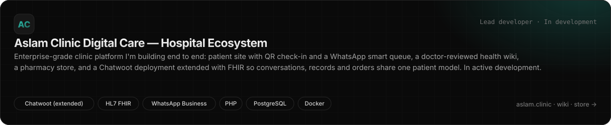
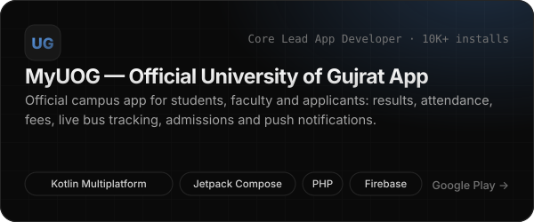
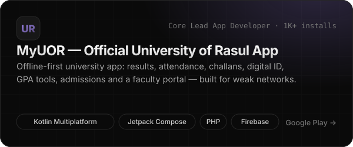
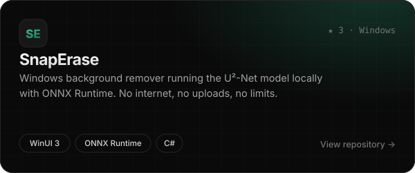
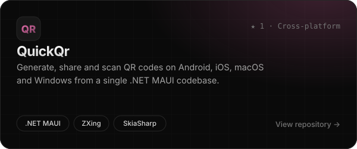
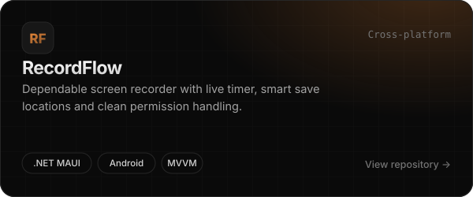
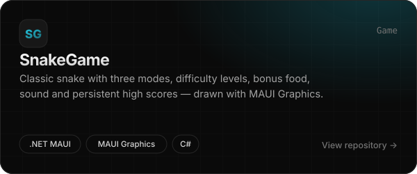
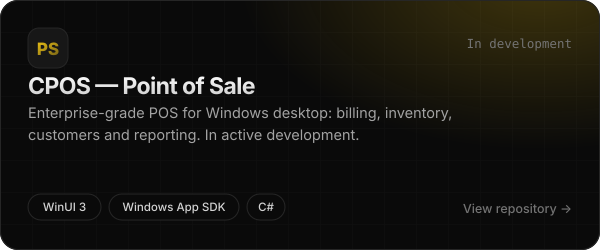
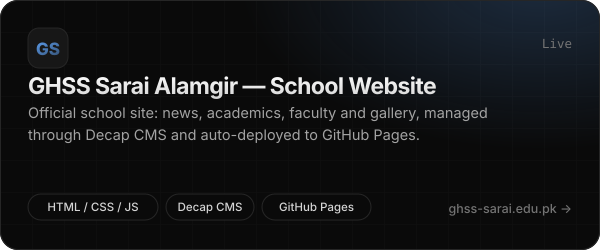

 

 

**Core Lead App Developer** behind the official apps of two Pakistani public universities, and an IT Specialist who likes software that works when the network doesn't.

- **Healthcare, end to end.** Currently building **Aslam Clinic Digital Care**, an enterprise-grade hospital ecosystem: [aslam.clinic](https://aslam.clinic) (patient site, QR check-in, WhatsApp smart queue), [wiki.aslam.clinic](https://wiki.aslam.clinic) (doctor-reviewed health explainers) and [store.aslam.clinic](https://store.aslam.clinic) (pharmacy), tied together by a **Chatwoot** deployment extended with **HL7 FHIR** so chat, records and orders share one patient model.
- **Mobile at university scale.** I lead development of **MyUOG** (University of Gujrat) and **MyUOR** (University of Rasul): Kotlin Multiplatform + Jetpack Compose clients, PHP services on top of the universities' management systems, and Firebase for auth, push and analytics.
- **Offline-first by default.** Cached screens, local databases and background sync, so results and attendance load on an entry-level phone with one bar of signal.
- **Native desktop & cross-platform.** WinUI 3 apps for Windows (SnapErase, CPOS) and .NET MAUI apps for Android, iOS and Windows.
- **On-device AI.** SnapErase runs the U²-Net segmentation model locally with ONNX Runtime; nothing leaves the machine.

 

## Featured work

<table>
  <tr>
    <td colspan="2"></td>
  </tr>
  <tr>
    <td width="50%"></td>
    <td width="50%"></td>
  </tr>
  <tr>
    <td width="50%"></td>
    <td width="50%"></td>
  </tr>
  <tr>
    <td width="50%"></td>
    <td width="50%"></td>
  </tr>
  <tr>
    <td width="50%"></td>
    <td width="50%"></td>
  </tr>
</table>

Also live: <a href="https://aslam.clinic/">aslam.clinic</a> · <a href="https://wiki.aslam.clinic/">wiki.aslam.clinic</a> · <a href="https://store.aslam.clinic/">store.aslam.clinic</a> · <a href="https://smuhammadbilalh.github.io/ugraphics/">UGraphics</a> · <a href="https://smuhammadbilalh.github.io/TechCenter/">TechCenter</a> &nbsp;—&nbsp; the university apps and the clinic platform are closed-source; their code lives in institutional repositories.

 

## Stack

 

## GitHub activity

  
  

  

Most of my commits for MyUOG and MyUOR land in private university repositories, so the graph above understates the real volume.

 

## Connect

 

